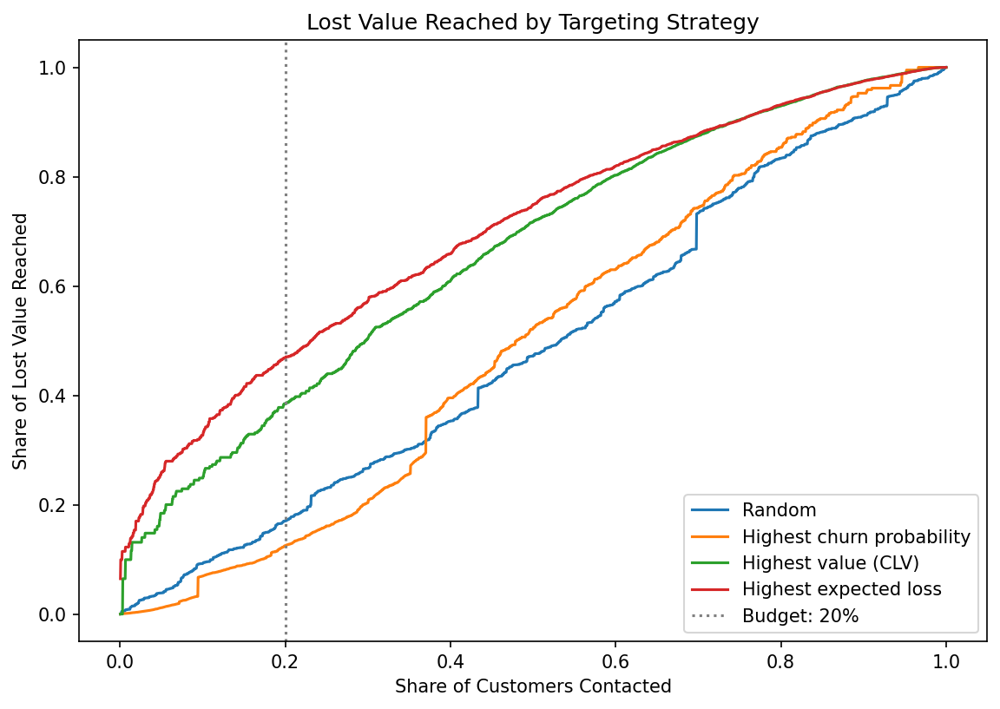
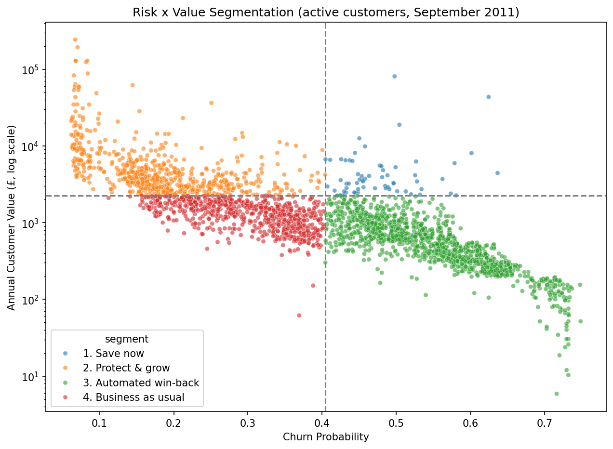

# 🛒 Customer Churn & CLV — Retention Targeting

An end-to-end Data Science project that predicts which customers of an online retailer will stop buying and uses the churn probability together with customer value to decide **who a retention campaign should target**.

## 🚀 Live Demo

👉 Try the interactive Retention Campaign Simulator *(link after deployment on Streamlit Cloud)*

The application allows users to:

- Choose a targeting strategy and the share of customers to contact
- Change the campaign assumptions (cost per contact, save rate, margin)
- Compare the net benefit of each strategy
- Explore the customer segments and the recommended action for each one
- Look up any customer and download the list of customers to contact

> ⚠️ This application is experimental. It is a backtest on historical data and the campaign assumptions should be validated with the business.

---

## 📌 Project Overview

My previous projects were regression problems. In this one I wanted to work on a **classification** problem with a clear business application: **customer churn**.

In a subscription business, customers cancel a contract, so churn is easy to observe. In an online retailer nobody cancels, customers simply stop buying. So the first challenge was to **define** churn from the raw transactions.

The project answers the question:

> **"With a limited budget, which customers should the retention campaign target to protect the most revenue?"**

---

## 🎯 Motivation

Most churn projects stop when the model has a good AUC. But a churn probability alone doesn't tell the business what to do.

The main objective was to go one step further and translate the model into a decision:

1. **Can we predict which customers will stop buying in the next 90 days?**
2. **How should the churn probability be combined with the value of each customer to choose who to contact?**

---

## 📊 Dataset

The project uses the [Online Retail II](https://archive.ics.uci.edu/dataset/502/online+retail+ii) dataset from the UCI Machine Learning Repository: all the transactions of a UK-based online retailer (gift products, mainly sold to wholesalers) between **December 2009 and December 2011**.

- 1,067,371 invoice lines
- Invoice, product, quantity, price, date, customer and country
- After cleaning: **776,579 sales lines from 5,852 customers** (£17.1M revenue)

---

## 🔍 Project Workflow

### 1. Data Understanding

Initial exploration of the raw data: structure, data types, missing values and data quality.

The most interesting finding was that the two sheets of the Excel file **overlap between 1 and 9 December 2010**, creating thousands of duplicated invoices.

### 2. Data Cleaning

- Duplicates removed
- Rows without Customer ID removed (22.8%, guest purchases that can't be followed over time)
- Non-product codes removed (postage, fees, manual adjustments)
- Cancellations saved separately as returns, used later as a feature

### 3. Exploratory Data Analysis

The EDA was focused on the decisions needed for the model:

- **Strong seasonality** before Christmas (September–November)
- **80% of repeat purchases happen within 77 days** → churn window of 90 days
- **The top 10% of customers generate 64% of the revenue** → customer value must be part of the decision

### 4. Churn Definition and Feature Engineering

> **Churn = an active customer (purchase in the last 180 days) who doesn't buy in the next 90 days.**

To avoid data leakage, the dataset was built with **quarterly snapshots**: the features only use the 180 days before each snapshot and the label only uses the 90 days after it. The split is **by time**, not random:

| Set | Snapshots |
|---|---|
| Train | Jun 2010, Sep 2010, Dec 2010, Mar 2011 |
| Validation | Jun 2011 |
| Test | Sep 2011 (Sep → Dec 2011) |

16 features were created: RFM (recency, frequency, monetary), recent activity, basket size, purchase cycle, spend trend, product variety, return rate and seasonality.

### 5. Model Development and Evaluation

Three approaches were compared:

- Recency rule (baseline)
- Logistic Regression
- LightGBM

Models were evaluated using ROC-AUC, PR-AUC, Lift and Brier score.

### 6. Business Impact

- CLV (annualised revenue) and **expected loss = churn probability × CLV**
- Comparison of targeting strategies
- Campaign simulation with explicit assumptions and sensitivity analysis
- Risk × value segmentation with a recommended action per segment

---

## 🤖 Final Model

The final model selected was **LightGBM**.

### Performance (test set, Sep → Dec 2011)

| Model | ROC-AUC | PR-AUC | Lift @10% | Brier |
|---|---:|---:|---:|---:|
| Recency rule | 0.658 | 0.534 | 1.59 | – |
| Logistic Regression | 0.731 | 0.586 | 1.75 | 0.200 |
| **LightGBM** | **0.733** | **0.590** | **1.76** | **0.200** |

Both Machine Learning models clearly beat the simple recency rule. Logistic Regression performed almost the same as LightGBM, which shows that the relationship between the features and churn is quite simple and that **good features matter more than a complex algorithm**.

The probabilities are well calibrated (average prediction 40.4% vs real churn rate 38.5%), so they can be multiplied by the value of each customer.

---

## 🧠 Model Interpretability

SHAP was used to understand the model:

- **Seasonality** has the biggest effect: before the Christmas peak the risk decreases for everyone.
- **Frequency** is the strongest protection: customers with many orders rarely churn.
- **Customers with only one order** have a higher risk.
- High **value** and many different **products** reduce the risk.
- High **recency** and a high **return rate** increase the risk.

As in my previous project, these results describe the behaviour of the model and should not be interpreted as causality.

---

## 💡 Business Impact

This is the most important result of the project.

Contacting **20% of the active customers** (555 customers):

| Strategy | Churners reached | Share of lost value reached |
|---|---:|---:|
| Random | 200 | 17% |
| Highest churn probability | 338 | 13% |
| Highest value (CLV) | 75 | 39% |
| **Highest expected loss** | 137 | **47%** |

Ranking customers only by churn probability finds the most churners, but most of them are small customers: it reaches **even less lost value than random**. Ranking by **expected loss** reaches **47% of the lost value**, almost 4 times more.



With my assumptions (£15 per contact, 20% save rate, 30% margin), the expected-loss strategy generates a **net benefit of about £26,900**, compared with £1,100 for the churn-probability strategy. The amounts depend on the assumptions, but the expected-loss strategy is the best for every save rate tested (10–30%).

### Customer segments

| Segment | Customers | Share of lost value | Recommended action |
|---|---:|---:|---|
| 1. Save now (high value, high risk) | 64 | 20% | Account manager call + tailored offer |
| 2. Protect & grow (high value, low risk) | 630 | 24% | Loyalty programme, cross-selling |
| 3. Automated win-back (low value, high risk) | 1,409 | 36% | Automated emails with discount |
| 4. Business as usual | 672 | 21% | Standard newsletter |



**Only 64 customers (2% of the base) concentrate 20% of the value lost.**

---

## ⚠️ Limitations

This is an educational and portfolio project, and there are some important limitations:

- **Prediction is not causality.** The model finds customers who are likely to leave, not customers whose behaviour a campaign would change. The next step would be an **A/B test** and an **uplift model**.
- The **CLV is a simple proxy** (annualised recent revenue). A BG/NBD + Gamma-Gamma model would give a better estimate.
- The campaign assumptions (cost, save rate, margin) are mine and should be validated with the business.
- The data only contains transactions. Marketing, web or customer service data would probably improve the model.
- There are only two Christmas seasons in the data.

---

## 🗂️ Project Structure

```text
customer-churn-cltv/
│
├── notebooks/
│   ├── 01_data_understanding.ipynb
│   ├── 02_data_cleaning.ipynb
│   ├── 03_eda.ipynb
│   ├── 04_churn_definition_and_features.ipynb
│   ├── 05_modeling.ipynb
│   └── 06_business_impact.ipynb
│
├── app_data/
│   └── customers_scored.csv
├── models/
│   └── churn_lgbm_model.pkl
├── images/
├── app.py
├── requirements.txt
└── README.md
```

To reproduce the project, download the dataset from the UCI repository, save `online_retail_II.xlsx` in `data/raw/` and run the notebooks in order.

## 🛠️ Technologies

Python
Pandas
NumPy
Matplotlib
Seaborn
Scikit-learn
LightGBM
SHAP
Streamlit
Git
GitHub
