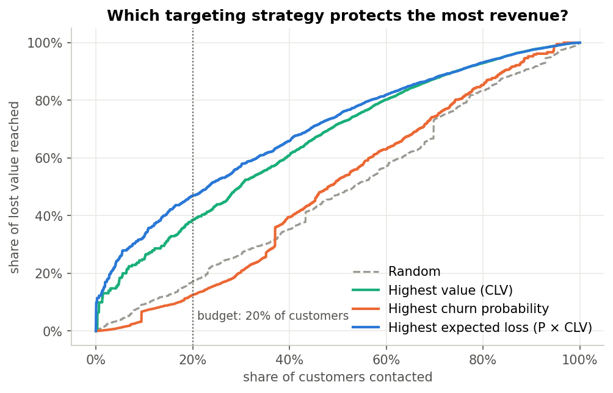
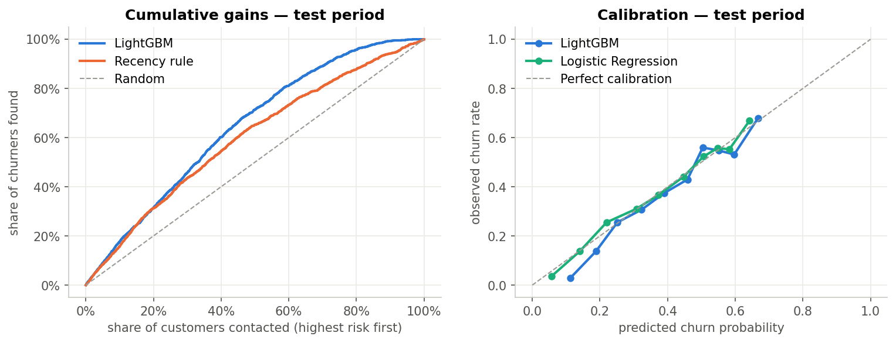
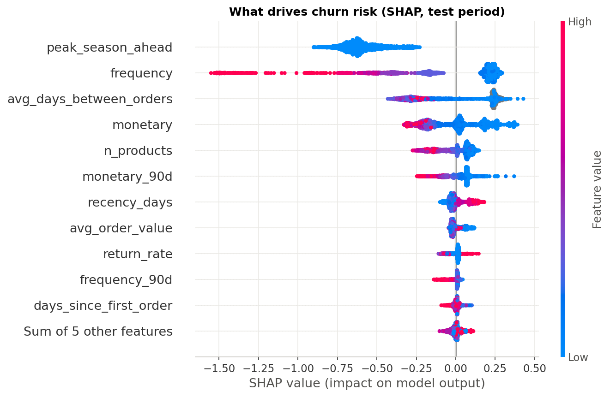
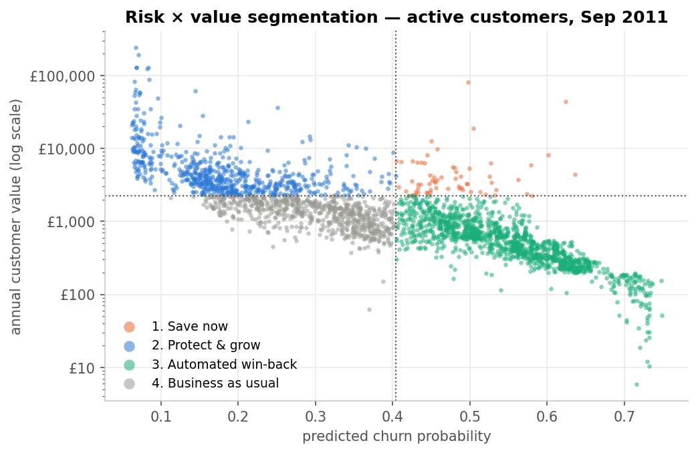

# Who should we try to keep? — Churn prediction & value-based retention targeting

**End-to-end customer analytics project:** from ~1M raw e-commerce transactions to a retention campaign
recommendation. Built around a business question, not a metric.

> **Business question:** a retailer has a limited retention budget for next quarter.
> *Which customers should the campaign target to protect the most revenue?*

**Key result:** ranking customers by **expected revenue at risk (churn probability × customer value)** reaches
**47% of the value lost to churn while contacting only 20% of customers** — almost **4× more** than a standard
"highest churn probability" list, which actually performs *worse than random* in value terms.



---

## Approach

| Step | What | Why |
|---|---|---|
| 1. Data preparation | Clean 1.07M invoice lines: duplicates from overlapping yearly sheets, 23% missing customer IDs, returns, non-product codes | Raw transactional data, as in a real project |
| 2. EDA | Seasonality, purchase cycles, revenue concentration | Justifies the churn definition and validation design |
| 3. Churn definition | Active customer (≥1 order in last 180 days) with **no order in the next 90 days** | Non-contractual business: churn must be defined; 80% of repeat orders happen within ~77 days |
| 4. Temporal validation | 6 quarterly snapshots: 4 train, 1 validation, **1 untouched test (Sep→Dec 2011)** | No leakage: features only use the past, labels only the future |
| 5. Modeling | Recency rule baseline vs. Logistic Regression vs. LightGBM | A model only matters if it beats the simple business rule |
| 6. Explainability | SHAP | Actionable reasons per customer |
| 7. Decision layer | CLV proxy, expected loss = P(churn) × CLV, campaign simulation with explicit cost/save-rate assumptions | Turn a score into a decision with a budget |
| 8. Segmentation | Risk × value matrix → next best action per segment | Operational output for marketing |

## Results

**Model performance — test period (Sep→Dec 2011, never seen during training):**

| Model | ROC-AUC | PR-AUC | Lift @ top 10% | Brier |
|---|---|---|---|---|
| Recency rule (baseline) | 0.658 | 0.534 | 1.59 | – |
| Logistic Regression | 0.731 | 0.586 | 1.75 | 0.200 |
| **LightGBM** | **0.733** | **0.590** | **1.76** | **0.200** |

* Both ML models clearly beat the business rule; performance is stable from validation to test.
* Logistic Regression is almost as good as LightGBM — the signal is mostly monotonic, so a transparent linear model is a defensible choice.
* Probabilities are well calibrated (mean prediction 40.4% vs. actual churn 38.5%), so they can be multiplied by £ values.



**Main churn drivers (SHAP):** the upcoming Q4 peak season lowers risk for everyone; order frequency is the
strongest protector; single-order customers, long time since last order and high return rates raise risk.



**Targeting with a 20% contact budget (test period):**

| Strategy | Churners reached | Share of lost value reached | Net benefit* |
|---|---|---|---|
| Random | 200 | 17% | – |
| Highest churn probability | 338 | 13% | £1.1k |
| Highest value | 75 | 39% | £20.6k |
| **Highest expected loss (P × CLV)** | 137 | **47%** | **£26.9k** |

\*Assumptions (explicit parameters in the notebook): £15 per contact, 20% of targeted churners retained, 30% gross
margin. The £ amounts depend on them; the ranking of strategies holds for save rates of 10–30%.

**Segmentation & next best action:**

| Segment | Customers | Share of value actually lost | Action |
|---|---|---|---|
| 1. Save now (high value, above-average risk) | 64 | 20% | Account-manager call + tailored offer |
| 2. Protect & grow (high value, low risk) | 630 | 24% | Loyalty programme, early Q4 access, cross-sell |
| 3. Automated win-back (low value, high risk) | 1,409 | 36% | Low-cost email sequence with discount |
| 4. Business as usual | 672 | 21% | Standard newsletter, no incentive spend |



## Recommendations

1. **Target by expected revenue at risk, not by churn probability.**
2. **Start with the 64 "Save now" customers** (~2% of the base, 20% of lost value) — personal contact pays off here.
3. **Automate win-back for low-value at-risk customers**; don't spend incentives on customers who aren't at risk.
4. **Act in September**, before the Q4 peak.

## Limitations & next steps

* **Prediction ≠ causal impact.** Next step: an A/B test or **uplift model** to measure which customers a campaign actually changes, and the real save rate.
* **CLV is a proxy** (annualised recent revenue) → a BG/NBD + Gamma-Gamma model would give a forward-looking CLV.
* **Only transactional data**; marketing contacts, web behaviour or service tickets would likely improve the model.
* Only two Q4 seasons in the data → monitor and recalibrate quarterly once deployed.

## Repository structure

```
├── notebooks/
│   └── churn_cltv.ipynb      # full analysis, end-to-end, with outputs
├── reports/figures/          # charts used in this README
├── data/                     # not versioned (see below)
├── requirements.txt
└── README.md
```

## How to reproduce

1. Download the dataset from the [UCI ML Repository](https://archive.ics.uci.edu/dataset/502/online+retail+ii) and place
   `online_retail_II.xlsx` in `data/raw/`.
2. Install dependencies: `pip install -r requirements.txt`
3. Run `notebooks/churn_cltv.ipynb`. The first run converts the Excel file to Parquet (a few minutes); later runs load in seconds.

**Tech stack:** Python · pandas · scikit-learn · LightGBM · SHAP · matplotlib

**Data source:** Chen, D. (2012). *Online Retail II* [Dataset]. UCI Machine Learning Repository. https://doi.org/10.24432/C5CG6D
